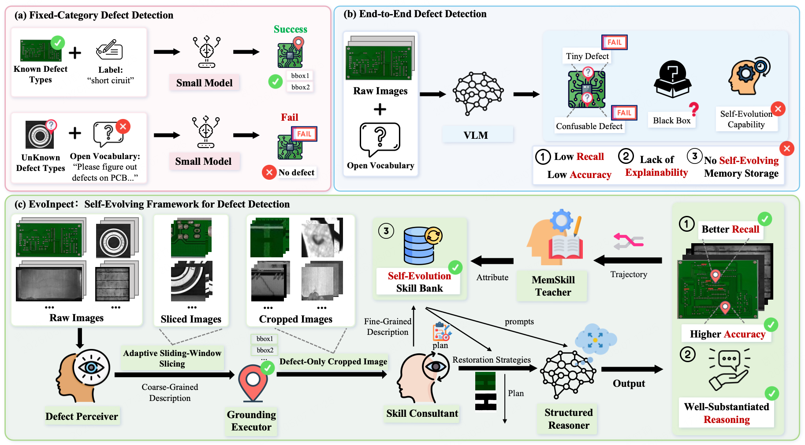
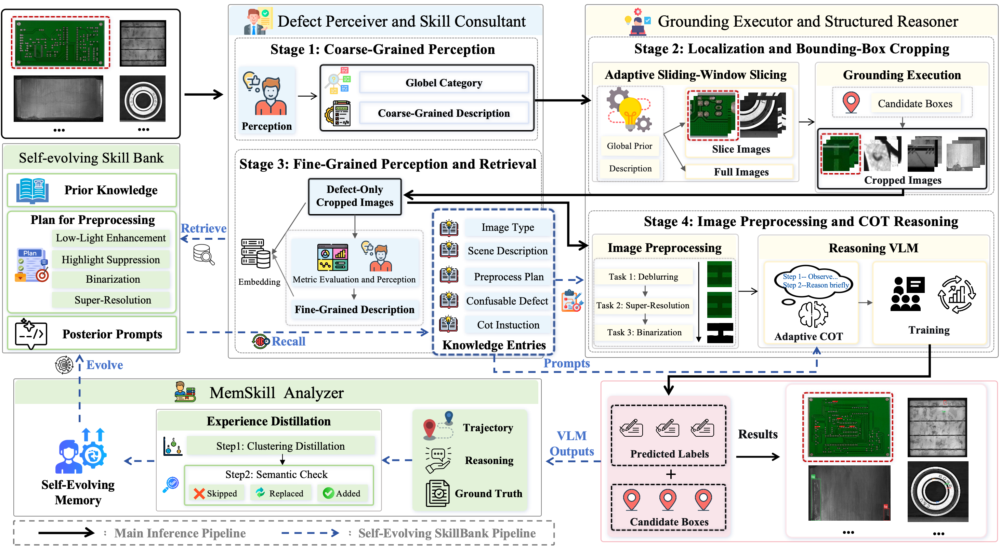

# EvoInspect: A Unified Self-Evolving Multi-Agent Framework for Industrial Hardware Inspection

## Abstract

Human experts can accumulate experience from open-ended and complex inspection tasks, thereby continually improving their inspection capabilities. Actually, industrial hardware inspection faces challenges including open-set defect categories, complex defects (tiny, high-gloss, low-light, or blurred), high inference cost, and difficulty in accumulating experience post-deployment. Existing end-to-end inspection methods typically couple image restoration with defect recognition in a single forward pass, limiting generalization to unseen components or composite defects; cascade “restore-then-detect” approaches often rely on static preprocessing, hindering adaptive adjustment based on scenario, defect morphology, and historical failures. To address this, we propose EvoInspect, the first memory-enhanced multi-modal multi-agent framework for industrial defect object detection. It leverages a multi-modal agentic memory mechanism to distill self-evolving scenario-specific Defect Detail Restoration decisions and dynamically grounded trajectories, enabling “accumulating experience like human experts.” Specifically, (1) we introduce a dynamic Defect Detail Restoration strategy, including adaptive slicing for tiny defects, highlight suppression, low-light enhancement, super-resolution, and binarization, combined with a coarse-to-fine token-efficient grounding mechanism for efficient defect capture; (2) we design a dual-track distillation mechanism unifying restoration and reasoning experience, incorporating both successful and failed offline feedback trajectories for training-free self-evolution of the Skill Bank. Experiments on bearing surfaces, PCBs, solar electroluminescence (solar EL), and magnetic tile datasets show that EvoInspect consistently outperforms strong baselines in defect localization recall, inference accuracy, while demonstrating cross-scenario adaptability and offline continual improvement.

## Introduction

- ✨ **A unified inspection framework with agentic memory:** EvoInspect connects coarse perception, open-vocabulary localization, local restoration planning, structured adjudication, and dual-track memory updates into a single pipeline. On bearing surfaces, PCBs, solar EL, and magnetic tile datasets, it achieves strong performance compared with representative large models (Qwen3.5, MiMo-VL) and is competitive with specialized small-object detectors (YOLO26), suggesting potential for broader industrial hardware defect inspection scenarios.
- 🔍 **A coarse-to-fine detection and restoration design:** We combine adaptive slicing for tiny defects with staged defect-detail restoration (including low-light enhancement, highlight suppression, super-resolution, and morphology-aware binarization) to improve the quality of evidence passed to the reasoner.
- 🧠 **A dual-track skill-evolution mechanism:** We maintain a cross-modal dual-track memory architecture with reusable restoration plans, jointly leveraging successful and failed trajectories to evolve strategy memory and reasoning memory, enabling learning from both successes and failures without updating deployed model weights.

## Pipeline

## Code

Coming Soon.

### TODO List

- [ ] Release the basic EvoInspect framework
- [ ] Release training code for Grounding Executor and Structured Reasoner
